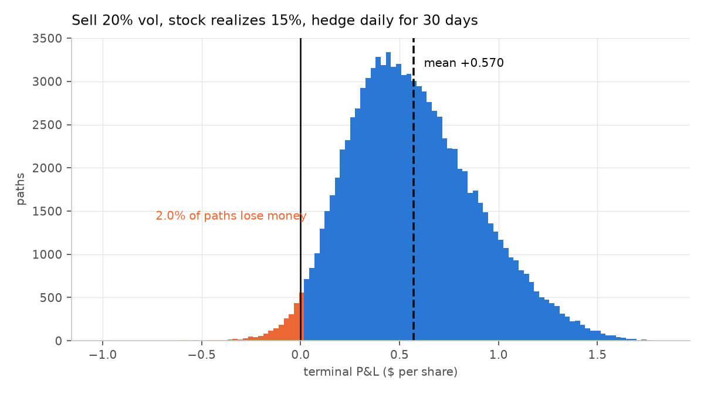
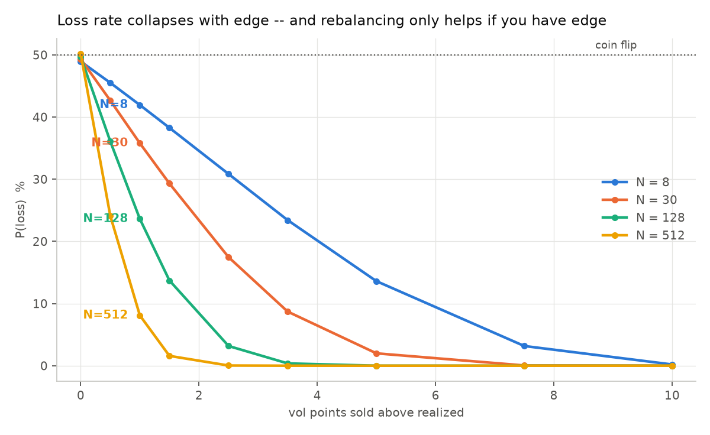
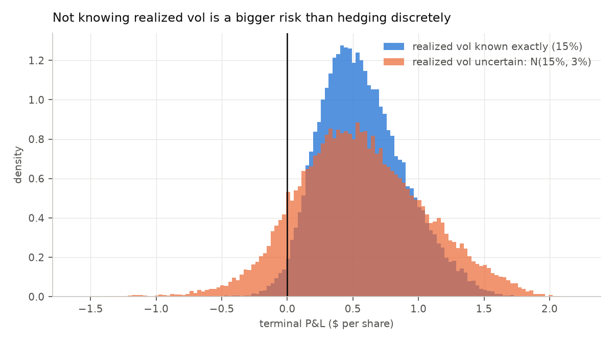

# Day 2 — How reliably does selling volatility pay?

Reproduce with `python day2_distribution.py` (~75s).

Setup throughout: 30-day ATM call on a $100 stock, sold at σᵢ = 20%, r = q = 0,
hedged at implied vol. "Edge" means vol points sold above realized.

---

## 1. The base case

Sell 20% vol, stock realizes 15%, rebalance daily (N=30), 100,000 paths.
Confidence intervals are percentile bootstrap (2,000 resamples) rather than
textbook standard errors, because those assume normality and the whole finding
here is that the distribution is skewed.

```
premium received      2.2872
mean P&L             +0.5703    95% CI [0.5683, 0.5724]
std                   0.3239
P(loss)               0.0197    95% CI [0.0188, 0.0205]
skew                 +0.4043    95% CI [0.3896, 0.4188]
mean / std            1.761

quantiles   p1=-0.065  p5=+0.097  p25=+0.336  p50=+0.538  p75=+0.778  p95=+1.154  p99=+1.402
worst path           -1.0150   (-44.4% of premium)
best path            +1.8253
```



**You sold a genuinely mispriced option, hedged it correctly, and still lost
money on 2% of paths.** The worst path gave back 44% of the premium collected.
That is the answer to "how reliably" at a 5-point edge: reliably, but not
certainly, and the tail is not trivial.

The skew is **+0.40**, positive, with a bootstrap CI that excludes zero. That is
the opposite of the folklore that short vol is negatively skewed — and it is not
a bug. See the caveat in §4.

---

## 2. Edge and rebalancing frequency

P(loss) across the grid, 30,000 paths per cell:

| edge (vol pts) | N=8 | N=30 | N=128 | N=512 |
|---:|---:|---:|---:|---:|
| 10.0 | 0.0020 | 0.0000 | 0.0000 | 0.0000 |
| 7.5 | 0.0317 | 0.0004 | 0.0000 | 0.0000 |
| 5.0 | 0.1360 | 0.0199 | 0.0000 | 0.0000 |
| 3.5 | 0.2341 | 0.0870 | 0.0037 | 0.0000 |
| 2.5 | 0.3084 | 0.1746 | 0.0317 | 0.0003 |
| 1.5 | 0.3827 | 0.2931 | 0.1371 | 0.0158 |
| 1.0 | 0.4194 | 0.3579 | 0.2361 | 0.0809 |
| 0.5 | 0.4551 | 0.4266 | 0.3608 | 0.2411 |
| 0.0 | 0.4894 | 0.4933 | 0.4970 | 0.5016 |



**Finding 1 — the loss rate is violently nonlinear in the edge.** At N=30,
halving the edge from 5.0 to 2.5 vol points takes P(loss) from 2.0% to 17.5%,
nearly nine times worse for half the edge. Selling 1 point above realized is
barely distinguishable from a coin flip (35.8%).

**Finding 2 — mean scales with edge, spread does not.**

```
edge 10.0 pts -> mean +1.1410
edge  5.0 pts -> mean +0.5704
edge  2.5 pts -> mean +0.2855
edge  1.0 pts -> mean +0.1146
```

Mean is almost exactly linear in the edge while std stays near 0.32–0.35, so
reward-to-risk is linear too, at roughly **0.35 per vol point** of edge. That is
a usable rule of thumb: a 3-point edge on a monthly ATM option buys you about
1.0 of mean-over-std.

**Finding 3 — rebalancing is worth nothing without edge.** Read the bottom row.
At zero edge, P(loss) sits at ~50% no matter how often you hedge, and going from
N=8 to N=512 does not move it. Rebalancing frequency is a *risk* decision, never
a *return* decision. It tightens the distribution around whatever mean your edge
gives you, and if that mean is zero it tightens around zero.

**A detail worth noticing in that bottom row:** at zero edge P(loss) is 48.9% at
N=8 and rises to 50.2% at N=512. It should be exactly 50% for a symmetric
distribution. It isn't at low N, because at low N the P&L is *negatively* skewed
by the discretization noise — most paths make a small gain, a few lose big — so
more than half the paths are winners. As N grows the discretization noise
symmetrizes and it converges to 50%. That is the skew crossover, showing up here
as a side effect. Day 5 measures it directly.

---

## 3. The caveat that dominates all of the above

Everything so far assumes σᵣ is **known in advance**. It never is. Same trade —
sell at 20% expecting 15% — but realized vol now drawn per trade from N(15%, s),
where s is how wrong your forecast typically is:

| forecast error s | mean | std | P(loss) | mean/std |
|---:|---:|---:|---:|---:|
| 0.000 | +0.5721 | 0.3246 | 0.0196 | 1.763 |
| 0.010 | +0.5770 | 0.3468 | 0.0306 | 1.664 |
| 0.020 | +0.5711 | 0.4011 | 0.0621 | 1.424 |
| 0.030 | +0.5568 | 0.4876 | 0.1138 | 1.142 |
| 0.050 | +0.5403 | 0.6998 | 0.1975 | 0.772 |



**Finding 4 — not knowing realized vol costs more than hedging discretely.** At
3 points of forecast error, P(loss) goes from 2.0% to **11.4%**, a 5.8× increase,
while the mean barely moves (+0.5721 → +0.5568). Forecast error does not eat
your edge; it inflates your variance. The std nearly doubles.

Compare magnitudes: going from N=512 to N=8 at a 5-point edge moves P(loss)
0.0% → 13.6%. Going from perfect vol knowledge to a 3-point forecast error moves
it 2.0% → 11.4%. **These are the same order of risk**, and only one of them is
under your control by trading more.

---

## 4. What this does and does not establish

**Established, and I'd defend these:**
- At a 5-point edge with daily hedging, P(loss) = 2.0% [1.9%, 2.1%]
- Mean is linear in edge; reward-to-risk ≈ 0.35 per vol point
- Rebalancing frequency does not create edge (bottom row of the grid)
- Forecast error on σᵣ inflates variance far more than it shifts the mean

**Not established, and do not quote these:**

The mean/std of 1.76 per trade is **an upper bound, not a forecast.** It is what
you get when realized vol is known exactly by construction. Roll that monthly and
you would get an annualized figure near 6, which no volatility seller earns. The
number is honest about the model and dishonest about the world; §3 is the first
step toward fixing it, not the fix.

The **positive skew (+0.40) is a property of this model, not of short vol.** Real
short-vol strategies are negatively skewed because realized vol is itself random
and fat-tailed, and because jumps exist. Here σᵣ is pinned by construction, so
the only skew left is the right-skew of the dollar-gamma integral. Do not read
this as evidence against the folklore — the model cannot see what the folklore is
about. The jump extension is where that gets tested.

σᵣ drawn from a **Normal is charitable.** Real realized vol is right-skewed and
fat-tailed; a normal forecast error understates the bad tail. §3 is therefore a
lower bound on the damage.

Everything here is one seed per cell. The base case has bootstrap CIs; the grid
does not. Cells at 30,000 paths carry roughly ±0.3–0.6 percentage points of
Monte Carlo noise on P(loss), which does not threaten any finding above but does
mean the 0.0000 entries should read "below resolution", not "impossible".
