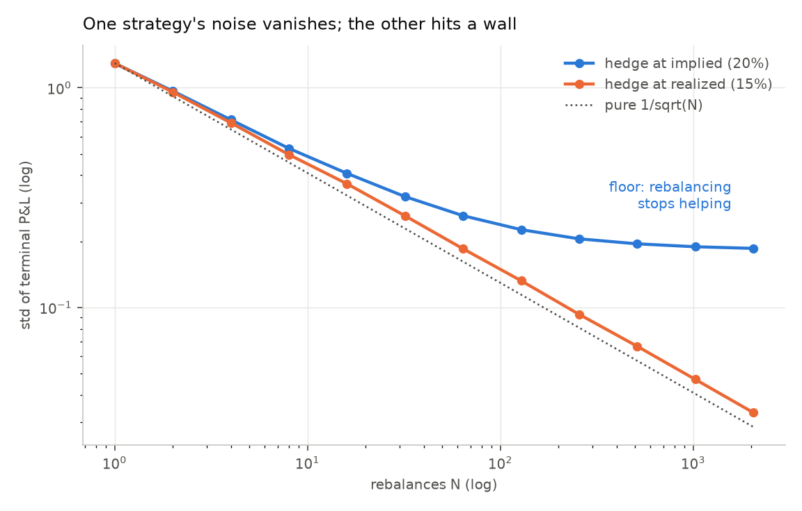
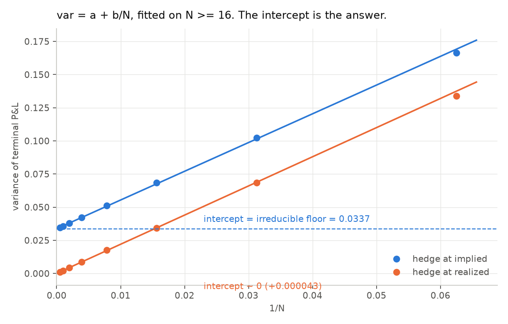
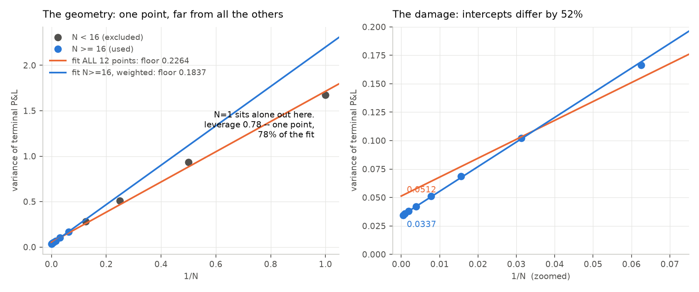

# Day 3 — How much of the P&L spread can rebalancing remove?

Reproduce with `python day3_convergence.py` (~75s).

Setup: 30-day ATM call on a $100 stock, sold at σᵢ = 20%, stock realizes
σᵣ = 15%, r = q = 0, 20,000 paths at each N.

---

## The question

Day 2 produced a distribution with std 0.32 at N=30. Part of that spread exists
because you rebalanced only 30 times instead of continuously — a *choice*, so
it's removable by trading more. The rest exists because the stock's route
matters, and trading more doesn't change the route it took.

This splits the two, and finds out how big each piece is.

---

## 1. The sweep

Same trade, only N changes:

| N | 1/N | var@implied | std | var@realized | std |
|---:|---:|---:|---:|---:|---:|
| 1 | 1.000000 | 1.673582 | 1.29364 | 1.674605 | 1.29403 |
| 2 | 0.500000 | 0.934822 | 0.96684 | 0.915002 | 0.95653 |
| 4 | 0.250000 | 0.511687 | 0.71530 | 0.480013 | 0.69281 |
| 8 | 0.125000 | 0.280902 | 0.52999 | 0.246450 | 0.49643 |
| 16 | 0.062500 | 0.166340 | 0.40784 | 0.133779 | 0.36575 |
| 32 | 0.031250 | 0.102215 | 0.31970 | 0.068314 | 0.26136 |
| 64 | 0.015625 | 0.068497 | 0.26171 | 0.034236 | 0.18502 |
| 128 | 0.007812 | 0.051110 | 0.22607 | 0.017526 | 0.13238 |
| 256 | 0.003906 | 0.042157 | 0.20532 | 0.008659 | 0.09305 |
| 512 | 0.001953 | 0.037977 | 0.19487 | 0.004434 | 0.06659 |
| 1024 | 0.000977 | 0.035721 | 0.18899 | 0.002215 | 0.04706 |
| 2048 | 0.000488 | 0.034519 | 0.18579 | 0.001104 | 0.03322 |



**Hedging at realized vol:** variance halves on every doubling of N, all the way
down. On the log-log plot it's a straight line parallel to the 1/√N reference.
There is no floor — hedge often enough and the spread goes to zero.

**Hedging at implied vol:** halves at first, then flattens near 0.034. Going from
N=512 to N=2048 — four times the trading — moved the std from 0.19487 to 0.18579,
about 5%.

---

## 2. The model, and why it's fitted in variance

```
P&L = [edge term] + [discretization noise]
```

The edge term is `½(σᵢ²−σᵣ²)∫S²Γdt`. It's random, but it **does not depend on N**.
The noise shrinks: halving the rebalancing interval quarters each error's
variance and doubles the number of errors, so the total halves. That's `var ∝ 1/N`.

Independent variances add; standard deviations do not. Checked at N=128, where
the floor is 0.0335 and the noise is therefore 0.0511 − 0.0335 = 0.0176:

```
adding variances:  √(0.0335 + 0.0176)      = 0.2260   vs measured 0.22607  ✓
adding std's:      √0.0335 + √0.0176 = 0.316                               ✗ off by 40%
```

So the decomposition only works in variance:

```
var(N) = a + b/N
```

Plotted against `1/N` that's a straight line, and **the intercept is the floor**.



---

## 3. The leverage trap

Plotting against `1/N` puts one point at x = 1.0 and crams the other eleven
below 0.5, eight of them below 0.07. Leverage — how much each point steers the
fitted line:

```
N=   1   x=1.000000   leverage 0.7777   <-- one point, 78% of the fit
N=   2   x=0.500000   leverage 0.1945
N=   4   x=0.250000   leverage 0.0903
...
N=2048   x=0.000488   leverage 0.1109
```

**One observation out of twelve controls 78% of where the line lands.** And it
moves the answer:

| fit range | fitted floor `a` | floor std |
|---|---:|---:|
| all 12 points | 0.051248 | 0.22638 |
| N ≥ 4 | 0.037377 | 0.19333 |
| N ≥ 16 | 0.034151 | 0.18480 |
| N ≥ 64 | 0.033504 | 0.18304 |



Including N=1 inflates the headline by **24%**. Reporting 0.226 would have been a
fake result — an artifact of one point, not a fact about hedging.

N=1 is the worst possible point to trust here, for two independent reasons that
compound: it has the most statistical influence, *and* it's where the model is
least valid, since `var = a + b/N` is derived from an argument about many small
steps and N=1 is one giant step. (The same breakdown showed up in exercise E2:
the 1/√N ratio from N=1 to N=128 came out 9.88 against a predicted 11.3.)

**Fix:** restrict to the asymptotic region and weight by `1/var²` so each point
counts equally in percentage terms rather than absolute terms.

| fit range (weighted) | floor std |
|---|---:|
| N ≥ 1 | 0.18734 |
| N ≥ 16 | 0.18366 |
| N ≥ 64 | 0.18302 |

Stable to under 2%. **An answer that stops moving when you change the fit range
is measuring something real; one that swings 24% is measuring your choice of fit
range.**

---

## 4. Two checks that make the number believable

**The control.** Theory says hedging at realized vol has no edge-term randomness
at all, so its floor must be exactly zero:

```
hedge at realized:  a = +0.00004283      (theory: exactly 0)
hedge at implied:   a = +0.03373052
ratio:              788x
```

The fit correctly finds nothing where there's nothing to find.

**The identification.** The fit says a floor exists and gives its size by
extrapolating to N = ∞. Theory says that floor should be the variance of
`½(σᵢ²−σᵣ²)∫S²Γdt`, which the engine accumulates separately and can be measured
directly:

| N | var(P&L) | var(gamma term) | corr |
|---:|---:|---:|---:|
| 128 | 0.050842 | 0.032431 | 0.8714 |
| 512 | 0.038393 | 0.033480 | 0.9588 |
| 2048 | 0.035009 | 0.033828 | 0.9890 |

```
fitted floor (extrapolated)   a = 0.033731    std = 0.18366
measured directly at N=2048   a = 0.033828    std = 0.18392
agreement: 0.3%
```

**Two independent routes to the same number, agreeing to 0.3%.** The
extrapolation never touches the dollar-gamma integral, and the direct measurement
never touches the fit. That, plus the control returning zero, is the whole case.

---

## 5. What each doubling of N actually buys

| N | std | irreducible share of var | std removed by this doubling |
|---:|---:|---:|---:|
| 8 | 0.53000 | 12.0% | 0.18532 |
| 16 | 0.40785 | 20.3% | 0.12215 |
| 32 | 0.31971 | 33.0% | 0.08814 |
| 64 | 0.26172 | 49.2% | 0.05799 |
| 128 | 0.22607 | 66.0% | 0.03564 |
| 256 | 0.20532 | 80.0% | 0.02075 |
| 512 | 0.19488 | 88.8% | 0.01044 |
| 1024 | 0.18900 | 94.4% | 0.00588 |
| 2048 | 0.18579 | 97.7% | 0.00321 |

At **N=64** — roughly twice a day for a monthly option — the position is already
half irreducible risk. By **N=256** it's 80%, and every further doubling buys
about a hundredth of a standard deviation.

Transaction costs grow like √N while this noise falls like 1/√N, so past that
point trading more is strictly value-destroying: you pay a rising cost to chase a
variance component that isn't moving.

---

## Where this leaves the original intuition

Your starting guess was that hedging error scales like 1/√N. That is **correct
for the error**, and the hedge-at-realized column confirms it cleanly. But it is
not the whole story for the P&L, because in the realistic case that 1/√N error
sits on top of a floor it can never reach:

```
std(N) = sqrt( 0.0337 + 2.20/N )
          ↑ irreducible   ↑ removable
```

At N=30 (daily) the removable part is about 68% of the variance. At N=256 it's
20%. The 1/√N law is real and the floor is real, and which one you notice
depends entirely on where you're standing.

---

## Caveats

Single seed per N; no error bars on the individual variance estimates. With
20,000 paths the relative standard error on a variance is roughly √(2/n) ≈ 1%,
which is small against the effects here but is not zero — the 0.3% agreement in
§4 is inside that noise and should not be read as more precise than the data.

The floor value is specific to this contract (30-day ATM, 5-point vol edge). The
*existence* of the floor is general; its size scales with `(σᵢ²−σᵣ²)` and with
the option's dollar gamma profile, so a different strike or tenor gives a
different number.
