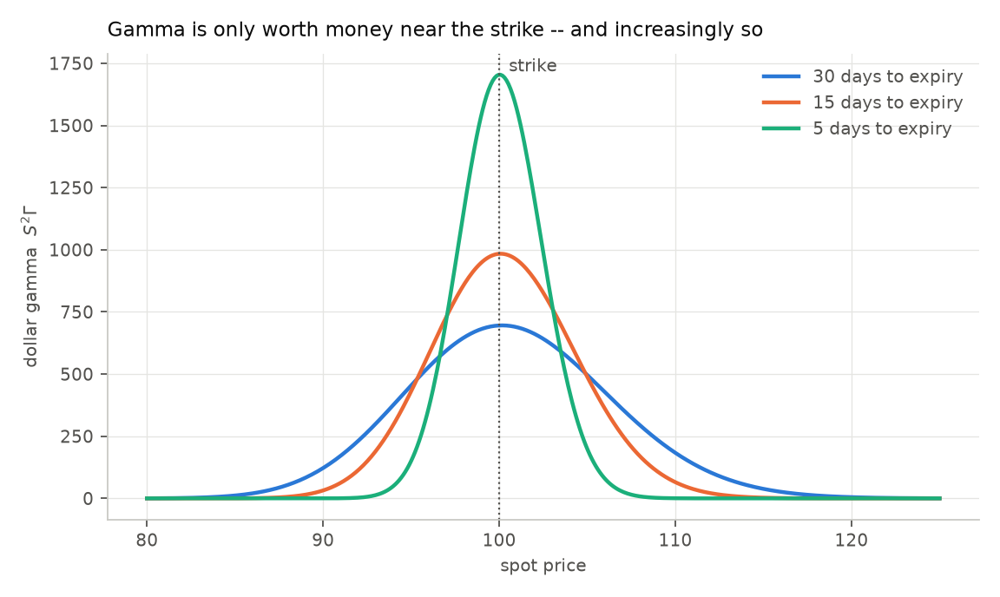
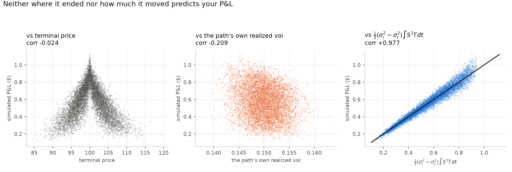
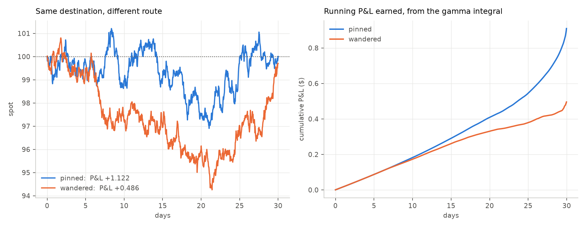

# Day 4 — Where the money physically comes from

Reproduce with `python day4_path_dependence.py` (~40s).

Setup: 30-day ATM call on a $100 stock, sold at σᵢ = 20%, stock realizes
σᵣ = 15%, r = q = 0.

---

## The question

Day 3 proved a floor exists and measured it (var 0.0337) by extrapolating a fit
to infinite rebalancing. That's a statistical argument — the floor is *inferred*,
never observed. Day 4 makes it physical:

```
P&L  =  ½(σᵢ² − σᵣ²) · ∫₀ᵀ S²Γ dt
```

not on average, but **path by path**. If that's right, knowing where one stock
path went is enough to predict that one path's P&L.

---

## 1. Dollar gamma: where gamma is actually worth money

`S²Γ` is how much P&L one unit of time generates. It depends on where the stock
is and how long is left:

| spot | 30d left | 15d left | 5d left | 1d left |
|---:|---:|---:|---:|---:|
| 85 | 11.5 | 0.3 | 0.0 | 0.0 |
| 90 | 122.0 | 31.9 | 0.1 | 0.0 |
| 95 | 454.3 | 430.7 | 150.6 | 0.0 |
| **100** | **695.5** | **983.8** | **1704.2** | **3810.8** |
| 105 | 496.2 | 488.7 | 198.9 | 0.1 |
| 110 | 183.2 | 65.1 | 0.4 | 0.0 |
| 115 | 38.2 | 2.8 | 0.0 | 0.0 |



Two things:

- **Gamma only pays near the strike.** At 30 days out, drifting from 100 to 110
  costs 74% of your dollar gamma; 115 costs 95%.
- **It concentrates as expiry approaches.** With 1 day left, spot 100 is worth
  3810 and spot 105 is worth 0.1 — a factor of 38,000.

So a path that drifts away late stops earning almost entirely, however well the
trade was going before.

---

## 2. The formula predicts individual paths

| N | corr | R² | |
|---:|---:|---:|---|
| 30 | 0.7283 | 0.5304 | formula explains 53% of cross-path variation |
| 128 | 0.8739 | 0.7637 | 76% |
| 512 | 0.9590 | 0.9197 | 92% |
| 2048 | 0.9889 | 0.9780 | **98%** |

The residual is exactly Day 3's discretization noise. As N grows the noise
shrinks and the formula takes over — which is why R² climbs. Two days' results
are the same fact seen from different angles.

---

## 3. What does *not* predict your P&L

At N=1024, 8,000 paths:

```
corr(P&L, terminal price)             -0.0238    <- nothing
corr(P&L, |terminal - strike|)        -0.7835
corr(P&L, path's OWN realized vol)    -0.2092    <- weak
corr(P&L, dollar-gamma integral)      +0.9774    <- almost everything
```



**Read the middle panel.** You would expect the amount a stock actually moved to
drive the P&L of a *volatility* trade. It barely does. What you're short is not
"movement" — it's movement **weighted by how much dollar gamma you were carrying
when it happened**.

### Sharpest version

Among the 742 paths that finished within $0.50 of the strike — effectively the
same ending:

```
P&L ranges  +0.4234  to  +1.1219     (spread 0.6985)
std among them 0.1062  vs  0.1888 across all paths
```

**Fixing the destination removes only about half the uncertainty.** The other
half is the route.

### Two honest caveats on those correlations

**The −0.024 on terminal price understates its information.** Look at the left
panel: it's a *tent*, peaked at the strike and falling both ways. Pearson
correlation measures only *linear* association, and a symmetric tent has none by
construction. That's why the table also reports `|terminal − strike|` at
**−0.78** — the destination genuinely matters, it just doesn't matter
*directionally*. Quoting −0.024 alone would be misleading.

**The realized-vol result is conditional, not universal.** Across these paths
realized vol only spans about 14%–16%, because they're all drawn from the same
GBM with σᵣ = 15%. Over a *wide* vol range, volatility obviously dominates — that
is Day 2's edge sweep, where the mean P&L is linear in σᵢ² − σᵣ². The correct
claim is narrower: **given the ensemble vol, an individual path's own realized
vol adds little**; the route matters more than that path's deviation from the
ensemble.

---

## 4. Two paths, same destination



```
PINNED     P&L +1.1219   ended 100.005   near strike 99.9% of the time
           gamma integral 103.94   its own realized vol 0.1456

WANDERED   P&L +0.4859   ended  99.697   near strike 58.0% of the time
           gamma integral  56.63   its own realized vol 0.1508
```

Same destination. **The wanderer realized *more* volatility** (0.1508 vs 0.1456)
and made **less than half as much**, because it spent its time where gamma was
worth nothing.

The right panel is the mechanism. The two earnings curves are identical for the
first ~8 days, then split the moment the paths separate. And notice the pinned
curve *steepening* over the final 5 days — that's the gamma concentration from
§1. Roughly a third of its total P&L is earned in the last five days, precisely
because it was still at the strike when gamma was worth the most.

Plain-language proxy: `corr(fraction of time within $3 of strike, gamma
integral) = 0.8918`. **"Time near the strike" is most of the story.**

---

## What this establishes

The floor from Day 3 is no longer an extrapolated number. It's `∫S²Γdt`, and at
N=2048 it accounts for **98% of the cross-path variation** in P&L.

Practically: **being right about volatility is necessary but not sufficient.**
Both paths above were sold at a 5-point edge and both realized close to 15%. One
collected 2.3× what the other did, and no change in hedging technique would have
closed that gap. Your payout is decided by where the stock chose to spend its
time — which is the one input you never control.

This is also why a single trade tells you nothing about whether you had edge, and
why Day 2 needed 100,000 paths.

---

## Caveats

Single seed throughout; correlations at 8,000 paths carry roughly ±0.01 of Monte
Carlo noise, which doesn't threaten any comparison here.

The two example paths are the extremes of a 742-path subset chosen *because* they
were extremes. They illustrate the mechanism; they are not evidence for it. The
evidence is §2 and §3.

`∫S²Γdt` uses gamma at the **implied** vol along the **realized** path, which is
what the derivation calls for. Using realized-vol gamma instead would be a
different (and wrong) quantity.
