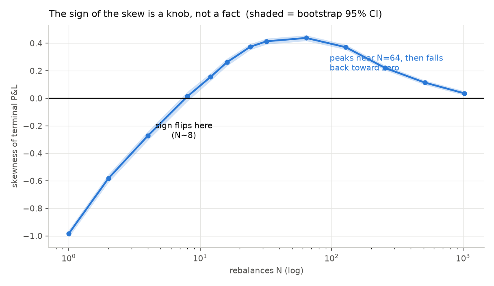
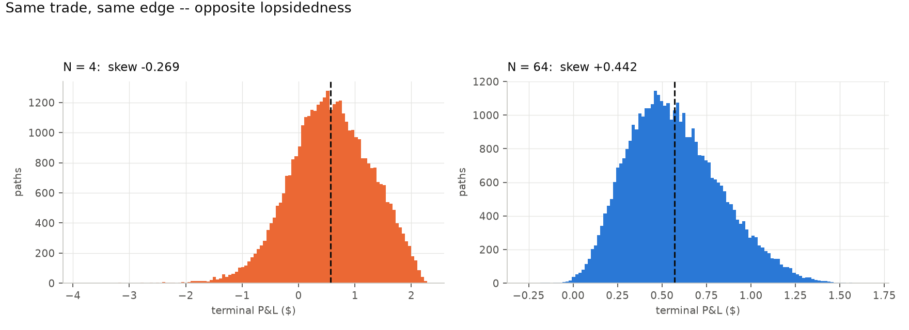
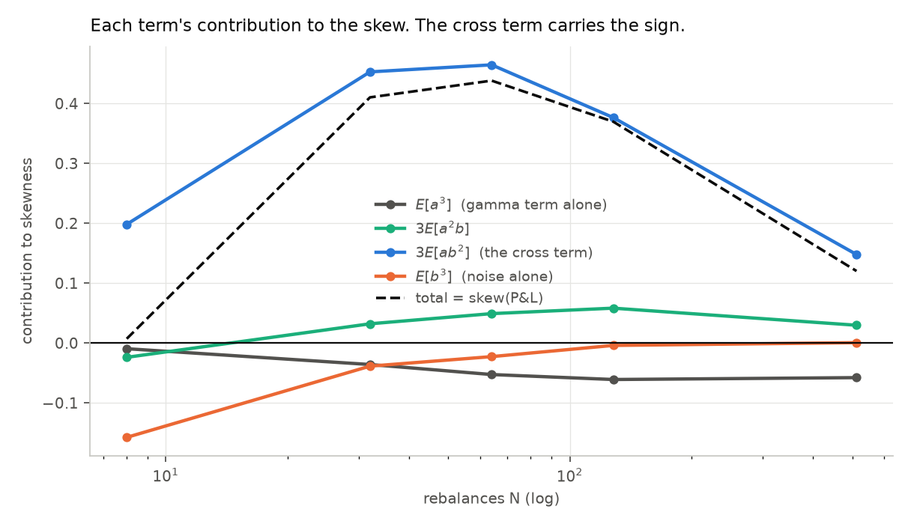

# Day 5 — Is the P&L distribution lopsided, and why?

Reproduce with `python day5_skew.py` (~2.5 min).

Setup: 30-day ATM call on a $100 stock, sold at σᵢ = 20%, stock realizes
σᵣ = 15%, r = q = 0, 40,000 paths per point.

---

## The question

Short volatility is famously **negatively** skewed — many small gains, rare large
losses. This model produces the **opposite** over most of its range, and the sign
depends on a parameter you choose.

Skewness is a third moment, and third moments are noisy, so every number here
carries a percentile bootstrap 95% CI. The textbook standard error `√(6/n)`
assumes normality, which is exactly the assumption under test; bootstrap makes
no such assumption.

---

## 1. The skew flips sign, then reverses

| N | skew | 95% CI | verdict |
|---:|---:|---|---|
| 1 | −0.9845 | [−1.0111, −0.9586] | negative |
| 2 | −0.5835 | [−0.6137, −0.5538] | negative |
| 4 | −0.2722 | [−0.3067, −0.2402] | negative |
| **8** | **+0.0139** | **[−0.0220, +0.0486]** | **ambiguous** |
| 12 | +0.1553 | [+0.1264, +0.1831] | positive |
| 16 | +0.2624 | [+0.2345, +0.2887] | positive |
| 32 | +0.4143 | [+0.3919, +0.4353] | positive |
| **64** | **+0.4385** | [+0.4169, +0.4586] | positive (peak) |
| 128 | +0.3714 | [+0.3531, +0.3902] | positive |
| 256 | +0.2199 | [+0.2031, +0.2380] | positive |
| 512 | +0.1140 | [+0.0976, +0.1303] | positive |
| 1024 | +0.0357 | [+0.0210, +0.0522] | positive |




Two features, both far outside the CIs:

- **The sign flips**, crossing zero around **N=8**
- **The skew peaks near N=64 and then falls back toward zero** — non-monotonic

**A single measurement at one N would have supported almost any story.** At N=4
you'd conclude short vol is negatively skewed (matching folklore, and for the
wrong reason). At N=64 you'd conclude strongly positive. At N=1024, symmetric.
Same trade, same edge, three incompatible conclusions.

---

## 2. Why — and it is not what it looks like

**A previous version of this analysis got the mechanism wrong**, and the error is
worth recording because it was plausible. The claim was: the dollar-gamma term is
right-skewed, the noise is left-skewed, and the sign flips as the noise shrinks.

Measured directly, splitting P&L into **A** (the dollar-gamma term) and
**B** (the discretization noise):

| N | skew(P&L) | skew(A) | skew(B) | std(A) | std(B) |
|---:|---:|---:|---:|---:|---:|
| 4 | −0.2635 | −0.7547 | −0.3695 | 0.115 | 0.651 |
| 16 | +0.2545 | −0.3459 | −0.1477 | 0.161 | 0.321 |
| 64 | +0.4479 | −0.1657 | −0.0827 | 0.177 | 0.160 |
| 256 | +0.2333 | −0.0921 | −0.0018 | 0.182 | 0.079 |
| 1024 | +0.0450 | −0.0669 | −0.0330 | 0.184 | 0.040 |

**Both components are negatively skewed at every N.** Yet the sum is positive
over most of the range. The gamma term is not right-skewed — it never was.

**Skewness is not additive.** Expanding the third central moment of A + B:

```
E[(a+b)³]  =  E[a³]  +  3E[a²b]  +  3E[ab²]  +  E[b³]
```

Measured, each term's contribution to the skewness:

| N | E[a³] | 3E[a²b] | **3E[ab²]** | E[b³] | total |
|---:|---:|---:|---:|---:|---:|
| 8 | −0.00147 | −0.00369 | **+0.03058** | −0.02432 | +0.0071 |
| 32 | −0.00116 | +0.00104 | **+0.01463** | −0.00125 | +0.4103 |
| 64 | −0.00094 | +0.00088 | **+0.00830** | −0.00041 | +0.4382 |
| 128 | −0.00072 | +0.00069 | **+0.00446** | −0.00005 | +0.3697 |
| 512 | −0.00044 | +0.00022 | **+0.00112** | +0.00000 | +0.1202 |



**`3E[ab²]` carries the sign.** It's the covariance between *where the stock went*
and *how big the hedging noise was*:

```
corr(gamma term, squared noise) at N=64 = +0.3310
```

Those aren't independent, and the reason is structural. From Day 1, the noise
contributed by each step is `−½S²Γσᵣ²dt(Z²−1)` — **proportional to `S²Γ`, the
very same quantity being accumulated in A.** A path that pins near the strike
accumulates a big gamma integral *and* carries wide hedging noise, because both
are driven by dollar gamma.

So high-A paths get extra spread in both directions. Since A is bounded below by
zero, that extra spread has more room on the right. **That is the positive skew.**

**And it explains the peak.** `3E[ab²]` scales with var(B), which dies like 1/N.
As N → ∞ the cross term vanishes and the skew converges to `skew(A)` alone —
which is about −0.07. The distribution isn't heading toward a positive limit; it's
heading back to mildly negative, slowly.

---

## 3. This is not the skew the folklore is about

At daily hedging (N=30): skew **+0.40**, CI [+0.377, +0.425]. Firmly positive.

Real short-vol books are negatively skewed. **The model is not wrong — it is
answering a question with two assumptions that remove exactly the thing the
folklore is about:**

1. **σᵣ is a known constant.** Real realized vol is random.
2. **The stock moves continuously.** No gaps. A delta hedge is helpless against a
   jump *by construction* — you cannot rebalance through it.

### Assumption 1, tested in isolation

Keep continuous paths; draw realized vol per trade from N(15%, s) instead of
fixing it:

| forecast error s | mean | std | skew | P(loss) |
|---:|---:|---:|---:|---:|
| 0.000 | +0.5731 | 0.3254 | **+0.4037** | 0.0196 |
| 0.010 | +0.5652 | 0.3458 | +0.3352 | 0.0321 |
| 0.020 | +0.5900 | 0.4028 | +0.1474 | 0.0574 |
| 0.030 | +0.6057 | 0.4741 | **−0.0053** | 0.0885 |
| 0.050 | +0.6046 | 0.6459 | **−0.1243** | 0.1613 |

**Assumption 1 alone flips the sign.** The skew crosses zero at roughly a
3-point forecast error and reaches −0.12 at 5 points — while the **mean barely
moves** (+0.573 → +0.605).

Why: `P&L = ½(σᵢ² − σᵣ²)·∫S²Γdt`. When σᵣ is random it occasionally lands
*above* σᵢ, and that bracket goes negative — a genuine loss, not a rounding
error. Those rare bad draws create a left tail the fixed-σᵣ model cannot produce
at all.

One of the two doors is now quantified. **Day 6 opens the other.**

### An aside: the sample minimum is not a risk measure

| paths drawn | worst | p0.1 | p1 |
|---:|---:|---:|---:|
| 1,000 | −0.1592 | −0.1582 | −0.0490 |
| 10,000 | −1.1629 | −0.2509 | −0.0636 |
| 100,000 | −1.1629 | −0.2704 | −0.0660 |
| 400,000 | −1.3955 | −0.3057 | −0.0669 |

The minimum drifts down as paths are added (−0.16 → −1.40) while p1 barely moves
(−0.049 → −0.067). **The sample min is a property of your sample size, not of the
distribution** — the same reason "worst drawdown in backtest" always gets worse
the longer you backtest. Quote percentiles.

This is the value of a negative result: the model's disagreement with reality
localizes what reality has that the model doesn't. The +0.40 isn't a finding about
volatility selling — it's a measurement of what continuous GBM with known vol
implies, and a pointer at the two doors marked "jumps" and "stochastic vol."

---

## What to take from this

**The defensible claim:** under GBM with known constant vol, the skew of
delta-hedged short-option P&L is a non-monotonic function of rebalancing
frequency, negative below N≈8, peaking near +0.44 at N≈64, and decaying toward
`skew(∫S²Γdt) ≈ −0.07` thereafter. The sign is driven by the covariance between
dollar gamma and squared hedging noise, not by the marginal skew of either
component.

**What not to claim:** anything about real short-vol strategies. This model
cannot see the mechanism that makes them negatively skewed.

---

## Caveats

Single seed per N; the bootstrap CIs cover sampling noise in the statistic, not
seed-to-seed variation in the simulation. A second seed would shift the point
estimates slightly but cannot move the sign flip or the peak, both of which span
many CI widths.

The four-term decomposition is exact arithmetic on the same sample, so its terms
inherit that sample's noise; the pattern (cross term dominant, others an order of
magnitude smaller) is stable across N and is the load-bearing part.

`skew(A)` at low N is contaminated by quadrature error — with N=4 steps the
"gamma integral" is a 4-rectangle approximation of a continuous integral, not the
integral itself. Its N-dependence in the table above is mostly that artifact. The
converged value near N≥256 is the meaningful one.
