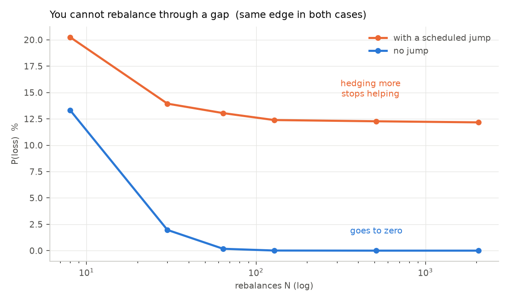
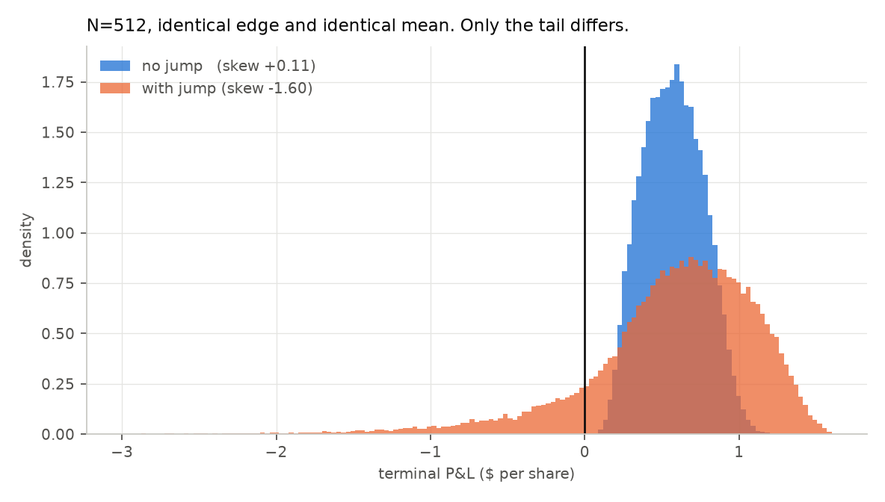
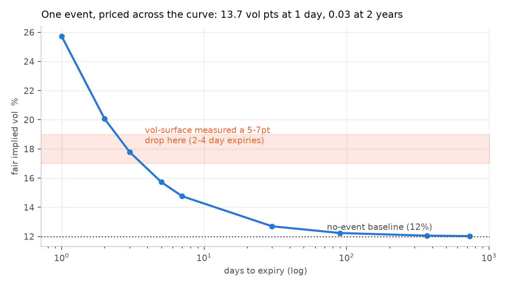
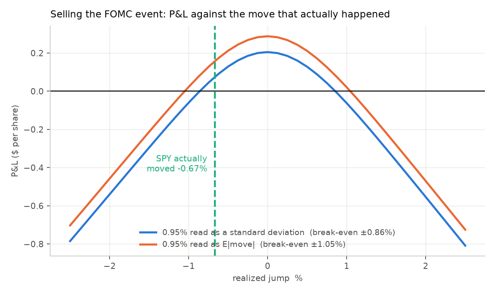

# Day 6 — What a scheduled jump does, and the FOMC trade

Reproduce with `python day6_jump.py` (~110s).

---

## The question

Day 5 found this model produces a **positively** skewed P&L and, at fine
rebalancing, **zero losses in 40,000 trades**. Both are false about the world. It
named two suspect assumptions and tested the first — known constant vol, which
alone flips the skew sign.

This tests the second: **continuous paths with no gaps.**

## What a scheduled jump is

A gap at a **known time** of **unknown size**. Earnings, an FOMC announcement, a
court ruling. The distinguishing feature isn't that it's large — it's that
**you cannot rebalance during it.**

Every other risk in this project shrinks with N, because more rebalancing means
smaller moves between trades. A jump doesn't shrink. You hold whatever delta you
had, the stock gaps, and you eat `½Γ(ΔS)²` on the entire move at once.

That's a structural difference, and it makes the prediction easy to state:
**P(loss) should stop going to zero.**

---

## 1. A correctly-priced jump still ruins the distribution

The comparison holds **edge constant**. A jump adds `jump_vol²` of variance, so
fair implied vol becomes `sqrt(σ_d² + σ_J²/T)`. Both columns sell 5 vol points
above their *own* fair value, so the only difference is the jump's presence — not
how well you were paid for it.

```
fair vol without jump : 0.1500
fair vol with 3% jump : 0.1829     (worth 3.29 vol pts at 30 days)
```

| N | | no jump | | | | with jump | |
|---:|---:|---:|---:|---:|---:|---:|---:|
| | mean | std | P(loss) | skew | mean | std | P(loss) / skew |
| 8 | 0.5738 | 0.5334 | 13.32% | +0.024 | 0.5688 | 0.8000 | **20.25%** / −0.803 |
| 30 | 0.5730 | 0.3257 | 1.97% | +0.421 | 0.5737 | 0.6333 | **13.94%** / −1.140 |
| 64 | 0.5714 | 0.2601 | 0.18% | +0.457 | 0.5745 | 0.5930 | **13.05%** / −1.310 |
| 128 | 0.5722 | 0.2257 | 0.01% | +0.367 | 0.5745 | 0.5778 | **12.39%** / −1.476 |
| 512 | 0.5726 | 0.1955 | 0.00% | +0.112 | 0.5727 | 0.5666 | **12.27%** / −1.603 |
| 2048 | 0.5719 | 0.1867 | 0.00% | −0.019 | 0.5708 | 0.5582 | **12.17%** / −1.604 |




**Three findings, and the first is the point of the day.**

**P(loss) stops falling.** Without the jump it runs 13.3% → 0.00%. With it,
20.3% → **12.2% and then flat**. Rebalancing 2,048 times instead of 128 buys
essentially nothing. This is the first quantity in the entire project that
rebalancing cannot touch at all — Day 3's floor limited how much *variance* you
could remove; this limits how often you *lose*.

**The skew flips hard negative, and gets worse with N.** +0.42 → −0.02 without
the jump; **−1.14 → −1.60** with it. Note the direction: more hedging makes the
skew *more* negative, because it strips out the diffusive noise and leaves the
jump as a larger share of what's left.

**The means are identical** (0.573 in both). You were paid fairly for the jump.
It did not help. Fair compensation buys you the right *mean*; it cannot buy you
back a shape you can't hedge.

---

## 2. Term structure: why event premium lives in the front

A jump contributes `jump_vol²` regardless of tenor; diffusion contributes
`σ²T`. So fair vol is `sqrt(σ² + σ_J²/T)`, which blows up as T shrinks.

With σ_d = 12% and σ_J = 1.19% (the July 2026 FOMC as priced — see §3):

| expiry | fair vol | event adds |
|---|---:|---:|
| 1 day | 0.2572 | **13.72pt** |
| 2 days | 0.2007 | 8.07pt |
| 3 days | 0.1779 | 5.79pt |
| 5 days | 0.1573 | 3.73pt |
| 1 week | 0.1476 | 2.76pt |
| 1 month | 0.1270 | 0.70pt |
| 1 year | 0.1206 | 0.06pt |
| 2 years | 0.1203 | **0.03pt** |



**Cross-check against vol-surface**, which measured front expiries falling 5–7
vol points when this event resolved, and the 2-year moving 0.3:

- **5–7 points corresponds to a 2–4 day expiry.** Consistent with what was
  observed.
- **2 years gets 0.03pt.** So the 0.3 observed there was *not* the event — it's
  noise or a market-wide shift. That is the same inference vol-surface drew,
  arrived at from the opposite direction: **that project inferred the jump size
  from the surface; this one predicts the surface from the jump size.**

Two independent projects, opposite directions, consistent answer.

---

## 3. Would selling the July 2026 FOMC have paid?

vol-surface measured the market pricing the announcement at **±0.95% of SPY**.

**That phrase is ambiguous and the ambiguity is worth 2× in the answer.** For a
normal jump, `E|J| = σ_J·√(2/π) = 0.798·σ_J`. So "±0.95%" means σ_J = 0.95% if
it's a standard deviation, or σ_J = 1.19% if it's an expected absolute move
(which is how straddle-implied moves are usually quoted). Both are carried
through rather than picking one.

Setup: 1-day ATM option spanning the announcement, diffusive vol 12%, hedged 48×.

| | 0.95% as std dev | 0.95% as E\|move\| |
|---|---:|---:|
| σ_J | 0.95% | 1.19% |
| 1-day implied vol | 0.2176 | 0.2572 |
| premium | 0.4543 | 0.5370 |
| **break-even move** | **±0.856%** | **±1.046%** |
| SPY actually moved | −0.67% | −0.67% |
| **P&L** | **+0.0740** | **+0.1568** |
| as % of premium | +16.3% | +29.2% |
| ex-ante P(profit) | 0.631 | 0.620 |



**It paid, under both readings.** SPY's −0.67% came in inside a break-even of
±0.86% to ±1.05%.

**But read the last row before celebrating.** Ex ante this was roughly a
**62/38 proposition**, not a free lunch. The trade won, and it was much closer to
a coin flip than a +16% to +29% return suggests.

And **n = 1.** One event, one outcome, no error bar. The defensible claim is
*"the priced premium exceeded the realized move on this occasion"* — not
*"selling FOMC events is profitable."* Distinguishing those two sentences is the
entire difference between an observation and a strategy.

---

## What Day 6 establishes

The model's two absurd implications from Day 5 are now both explained:

| Day 5 problem | cause | evidence |
|---|---|---|
| skew is positive (+0.40) | both assumptions | vol uncertainty: +0.40 → −0.01; jump: +0.42 → −1.60 |
| P(loss) → 0 as N grows | the no-gaps assumption | P(loss) plateaus at 12.2% with a jump |

The second is the sharper one. Vol uncertainty fattens the left tail but leaves
P(loss) improvable by hedging. **A jump makes a floor under your loss rate that
no trading can lift.** That is the structural reason real vol sellers blow up
and this model, before Day 6, said they couldn't.

---

## Caveats

**The jump is Gaussian.** Real event moves are fat-tailed relative to a normal —
occasionally the announcement is a genuine shock. A Gaussian jump therefore
*understates* the tail, so 12.2% is a floor on the floor.

**One jump, at the midpoint, of known timing.** Real books face several events
per option life, and timing is not always certain.

**σ_real describes only the diffusive part.** With a jump the total realized
variance is `σ_r²T + σ_J²`; the code and tests state this, but it's easy to
misread the parameter.

**The FOMC section is n=1 and depends on an interpretation.** The 2× spread
between the two readings of "±0.95%" is larger than most of the effects measured
elsewhere in this project. If you quote one number, quote the range.

**Diffusive vol of 12% for SPY on an FOMC day is an assumption**, not a
measurement. It's plausible but was not estimated from data, and the break-even
moves with it.
