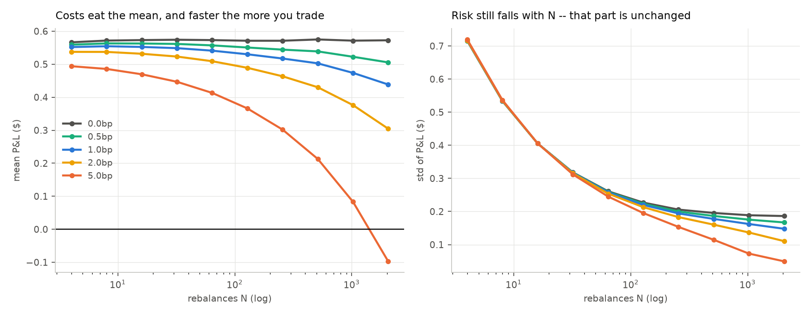
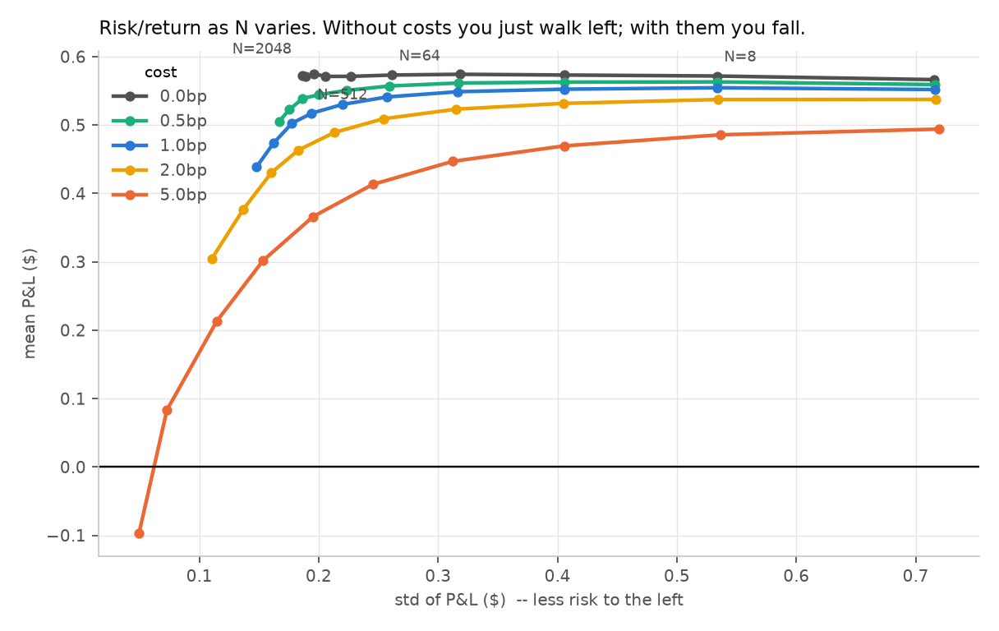

# Day 7 — Transaction costs and the optimal rebalancing frequency

Reproduce with `python day7_costs.py` (~6 min).

Setup: 30-day ATM call on a $100 stock, σᵢ = 20%, σᵣ = 15% (a 5 vol point edge),
r = q = 0. Cost is proportional, quoted in basis points of notional traded, and
charged on every share in either direction.

---

## The question

Day 3 concluded that past N≈256 "you are paying for nothing." **"Paying" was
doing real work in that sentence and had never been measured.** This measures it.

## The tension

Cost per rebalance is proportional to shares traded, which is roughly
`Γ·|move| ≈ Γ·σ·S·√dt`. Multiply by N rebalances:

```
total cost ≈ N · k·σ·S²Γ·√(T/N)  =  k·σ·S²Γ·√(T·N)     ∝ √N
```

So **cost grows like √N while hedging noise falls like 1/√N.** One rising, one
falling — a genuine interior optimum, which the cost-free case did not have.

---

## 1. Costs do grow like √N — once you separate the fixed legs

Entering the hedge is a one-off trade (0.5114 shares × $100 = $51.14), and
unwinding at expiry is another. Those legs don't scale with N and dominate the
total at low N, which makes the raw total *look* like it breaks the law:

| N | total $ | entry+exit | rebalancing | rebal/√N |
|---:|---:|---:|---:|---:|
| 8 | 172.03 | 101.44 | 70.59 | 24.958 |
| 32 | 253.22 | 100.91 | 152.31 | 26.925 |
| 128 | 409.02 | 101.50 | 307.52 | 27.181 |
| 512 | 721.86 | 101.12 | 620.74 | 27.433 |
| 2048 | 1334.23 | 101.43 | 1232.79 | 27.241 |

**Last column flat ⟹ the rebalancing leg is √N.** (The N=8 value is 8% low for
the same reason it always is: √N is asymptotic and N=8 isn't asymptotic.)

Asserted in the test suite as `rebal/√N` varying by less than 5% across
N = 128, 512, 2048. Measured spread: **0.9%**.

---

## 2. Mean and risk against N

| N | 0bp mean | 0bp std | 1bp mean | 1bp std | 5bp mean | 5bp std |
|---:|---:|---:|---:|---:|---:|---:|
| 8 | 0.5716 | 0.5334 | 0.5544 | 0.5340 | 0.4857 | 0.5365 |
| 32 | 0.5741 | 0.3181 | 0.5487 | 0.3166 | 0.4468 | 0.3120 |
| 128 | 0.5711 | 0.2269 | 0.5301 | 0.2199 | 0.3661 | 0.1953 |
| 512 | 0.5750 | 0.1956 | 0.5026 | 0.1776 | 0.2130 | 0.1145 |
| 2048 | 0.5724 | 0.1863 | 0.4385 | 0.1478 | **−0.0972** | 0.0494 |



**Read the bottom-right cell. At 5bp and N=2048 the mean is −0.0972.**

The edge was real — 5 vol points, worth +0.57 before costs. Hedging 2,048 times
paid it all away and then some. **You can convert a genuinely profitable trade
into a losing one purely by trading it too carefully.**

Note the std column still behaves: risk keeps falling with N at every cost level.
Costs don't stop you from reducing risk. They just make you pay more for it than
it's worth.

---

## 3. Optimal N

Costs hit the **mean**. Hedging noise is a **variance**. Different units — they
cannot be added, so "optimal N" is undefined until you say how you trade one
against the other. Using `U = mean − (λ/2)·variance`:

| cost | λ=0.5 | λ=1 | λ=2 | λ=5 | λ=10 |
|---:|---:|---:|---:|---:|---:|
| 0.0bp | 512 | 512 | 2048 | 2048 | 2048 |
| 0.5bp | 64 | 128 | 256 | 512 | 1024 |
| 1.0bp | 64 | 64 | 128 | 512 | 512 |
| 2.0bp | 32 | 64 | 64 | 256 | 512 |
| 5.0bp | 16 | 32 | 64 | 128 | 256 |



**The top row is the control.** With zero costs the optimum is always the largest
N available — more hedging is weakly better and never worse, so there is no
interior optimum at all. **Costs are what create one.**

At **1bp with λ=2** (a moderately risk-averse desk), the answer is **N=128** —
about four rebalances a day on a monthly option. Day 3 said "past 256 is waste";
with costs priced in, the answer is sharper and lower.

The honest output here is the *table*, not a number. Anyone quoting a single
optimal N is hiding a risk-aversion assumption inside it.

---

## 4. What this changes about the earlier results

### Day 2 survives almost intact

At daily hedging you only trade 30 times, so there isn't much cost to pay:

| cost | mean | P(loss) | vs 0bp |
|---:|---:|---:|---:|
| 0.0bp | 0.5723 | 1.99% | — |
| 0.5bp | 0.5598 | 2.22% | +0.23pp |
| 1.0bp | 0.5473 | 2.53% | +0.54pp |
| 2.0bp | 0.5223 | 3.19% | +1.20pp |
| 5.0bp | 0.4473 | 5.99% | +4.00pp |

And the edge threshold is **unchanged**: ~5 vol points still gets P(loss) under
5% at 0, 1, and 2bp.

**Costs are a second-order correction to Day 2, not a revision of it.** That's
worth stating plainly, because the intuition "costs must matter a lot" is wrong
at realistic hedging frequencies. The cost damage lives at high N, and daily
hedging isn't high N.

### Day 6 gets *sharper*, not weaker

With 1bp of cost, hedging into a scheduled jump stops being merely useless and
becomes **harmful**:

| N | no jump | with jump |
|---:|---:|---:|
| 30 | 2.51% | 15.02% |
| 128 | 0.01% | **13.39%** |
| 512 | 0.00% | 13.48% |
| 2048 | 0.00% | **14.42%** |

The jump column bottoms out at N=128 and then **rises** to 14.42% at N=2048.

Without costs that column was flat past 128 — extra hedging was wasted but
harmless. **With costs it turns actively value-destroying: you pay a rising bill
to reduce a risk that is not the one hurting you.** The gap is what's killing
you, and no amount of rebalancing touches the gap.

That combination — a floor you can't lower and a cost that keeps climbing — is
the cleanest statement of why event risk is different in kind from ordinary
volatility risk.

### Days 3, 4, 5 unaffected

Day 3's variance decomposition, Day 4's dollar-gamma mechanism, and Day 5's skew
decomposition are all statements about the *structure* of the P&L, not its level.
Costs shift the mean without changing what drives the shape.

---

## Caveats

**Proportional costs only.** Real execution has a fixed component (ticket fees),
a spread component (modelled here), and market impact that grows with size. Only
the middle one is here. Impact would penalize high N more, pushing the optimum
lower still — so the optimal-N table is an upper bound.

**Cost is charged on notional, not shares.** Equivalent for a proportional
spread, wrong if your broker charges per share.

**1bp is roughly right for SPY and too tight for a single name.** SPY's spread is
often under a cent on ~$600, so under 0.2bp half-spread; individual equities can
be several bp. The 0.5–5bp range spans the realistic cases, and *which* row you
read matters more than any other assumption in this file.

**λ is not estimated from anything.** It's a preference parameter, swept rather
than fitted. The table is a menu, not a recommendation.

**Single seed per cell**, ~20k paths. Optimal-N entries adjacent in utility can
swap under a different seed; the *pattern* (optimum falls as cost rises, rises as
risk aversion rises) is robust, individual cells are not.
