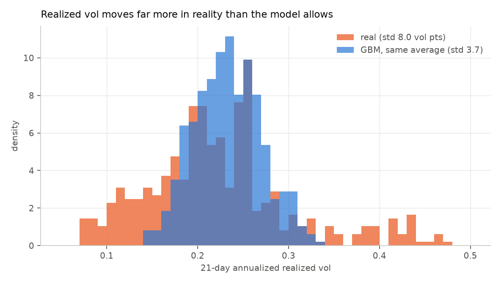
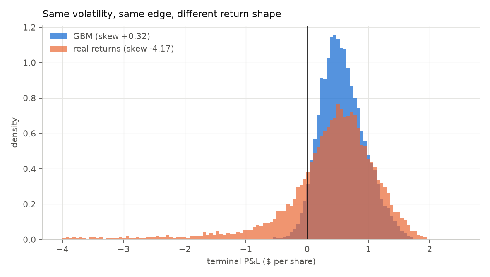

# Day 8 — Real price paths

Reproduce with `python day8_real_paths.py` (~30s).

Data: `data/spy_daily.csv`, 2,513 daily closes, Aug 2016 – Aug 2026.

---

## Read this before the results

**The sample is limited.** 2,513 days, 21-day windows, **about 119 independent
months.** Better than a toy, far from a population. This day is a *check* on the
conclusions of Days 1–7, not a source of new ones.

**And the decade is not neutral.** Aug 2016 – Aug 2026 contains February 2018,
March 2020, and 2022. Those are real and belong in any honest sample, but they
mean the tail statistics below describe *this* decade, not a stationary truth.

**And it cannot attribute anything.** Real paths carry fat tails, volatility
clustering, and gaps for free, without any of them being modelled — that is the
appeal. It is also why Day 6 came first: Day 6 changed *one* thing and could
therefore say *this feature causes that effect*. Day 8 changes everything at once
and can only say *reality differs, by this much*.

That ordering is deliberate. Real data is the last step, not the first.

---

## 1. What real returns have that GBM does not

```
annualized vol                      0.1800
daily return skew                   -0.598
daily return kurtosis               18.264   (normal = 3.000)
days with |move| > 4 sd                 20   (normal expects ~0.03)
vol clustering corr(|r_t|,|r_t-1|) +0.3618
  same for iid normal              -0.0169
```

**Kurtosis 18.3 against 3.0.** Twenty days moved more than 4 standard deviations;
a normal expects **0.03**. That is roughly 600× too many.

**An index is more fat-tailed than the single stock, not less.** AAPL over its
two years gave kurtosis 6.1 and four 4-sigma days. SPY gives 18.3 and twenty.
That inverts the naive intuition that diversification tames the tails, and the
reason is that it only tames the *idiosyncratic* part. A single stock's daily
return is mostly company-specific noise, which fattens the body of the
distribution and dilutes the tail relative to it. An index strips that noise out
and leaves the correlated, market-wide moves — which is exactly what a crash is.

Volatility clustering is also **2.6× stronger** on the index: +0.362 against
AAPL's +0.139, versus −0.017 for iid noise.

---

## 2. The loop back to Day 2

Day 2 swept a realized-vol forecast error `s` from 0 to 5 vol points **as an
assumption**, finding P(loss) went 2.0% → 16.1%. Real data prices that sweep.

Distribution of 21-day annualized realized vol:

| | mean | std | p5 | p95 |
|---|---:|---:|---:|---:|
| real | 0.1461 | **0.0998** | 0.0594 | 0.2855 |
| GBM, same average | 0.1737 | **0.0272** | 0.1312 | 0.2197 |



**Real 21-day realized vol has a standard deviation of 10.0 vol points. GBM with
the same average gives 2.7. A ratio of 3.67×.**

Look at the percentiles rather than the standard deviation: real 21-day vol runs
from **5.9% to 28.6%** between the 5th and 95th percentile — a factor of nearly
five. GBM spans 13.1% to 22.0%.

So **Day 2's harshest assumed scenario — s = 5 points — was still optimistic by
half.** The month-to-month spread of realized vol *by itself* is 10 points, before
any forecasting error is layered on top. Day 2 guessed at a parameter; this
measures it, and the guess was too kind.

*(Caveat: the windows overlap heavily — 2,492 of them carry about 119 months of
independent information.)*

---

## 3. Hedging real paths

### Matching the edge, not just the volatility

The reference vol here is the **mean 21-day window vol (14.61%)**, not the
full-sample vol (18.00%). Those are different numbers and using the wrong one
silently biases the comparison.

Full-sample vol is `sqrt(average variance)`. Mean window vol is
`average of sqrt(variance)`. Square root is concave, so **Jensen's inequality
makes the second strictly smaller**, and the gap grows with how dispersed the
window vols are — 1.9 points for AAPL, 3.4 points for SPY.

Selling 5 points above the *full-sample* figure therefore hands the real paths
more edge than the GBM control gets, because GBM realizes its sigma by
construction while the typical real window realizes less. On SPY that inflated
the real mean by 53%, which matched the variance-edge ratio of 1.539 almost
exactly — **the entire mean difference was the mismatch, not a property of real
returns.**

Both sides now sell 5 points above the same reference, so the only remaining
difference is the shape of the return distribution.

Both sides sell at 19.61% — 5 points above 14.61% — so the only remaining
difference is the shape of the return distribution.

| | n | mean | std | P(loss) | skew | p5 |
|---|---:|---:|---:|---:|---:|---:|
| real, overlapping windows | 2,492 | 0.5024 | 0.9629 | **21.99%** | **−3.600** | −1.0191 |
| real, block bootstrap | 20,000 | 0.3144 | 1.0692 | **21.81%** | **−4.165** | −1.3228 |
| GBM (control) | 20,000 | 0.5751 | 0.3607 | 3.69% | **+0.321** | **+0.0385** |



**The skew is −4.17 on real returns against +0.32 for volatility-matched GBM.**
Matched on volatility, matched on edge, matched on rebalancing frequency.

Days 5 and 6 predicted this by *adding features to the model*. Day 8 confirms it
by *removing the model*. Two routes, no shared assumptions, same conclusion.

The rest of the comparison:

- **P(loss) is 5.9× higher**, 3.7% → 21.8%
- **The mean is 45% lower**, 0.575 → 0.314, at identical edge
- **Spread is 3× wider**, 0.36 → 1.07
- **GBM's 5th percentile is POSITIVE (+0.0385).** The model says 95% of months
  make money. Reality says 22% lose, and the 5th percentile is **−1.32** — more
  than twice the average profit, lost.

That last row is the sharpest statement in the project. Under the model, a bad
month is a small gain. In the data, a bad month wipes out two average months.

**The mean matters too.** At identical edge, real returns *underperform* the
model by 45%. Fat tails cost more in gamma on the violent days than the calm days
save in theta — which is precisely the `½Γ(ΔS)²` asymmetry from Day 6, arriving
without anyone modelling a jump.

### Compare against AAPL — the result strengthens on the index

| | AAPL (2y, single name) | SPY (10y, index) |
|---|---:|---:|
| kurtosis | 6.1 | **18.3** |
| 4-sigma days | 4 | **20** |
| vol clustering | +0.139 | **+0.362** |
| vol dispersion vs GBM | 2.20× | **3.67×** |
| skew, real | −0.670 | **−4.165** |
| skew, GBM control | +0.253 | +0.321 |
| P(loss) real / GBM | 2.6× | **5.9×** |

**This is the comparison that matters, and it rules something out.** Three of
AAPL's four 4-sigma days fell on its earnings calendar — scheduled jumps, exactly
Day 6's setup occurring naturally. That left open the reading that the AAPL result
was really about events rather than about return shape.

**SPY has no earnings.** Its twenty 4-sigma days are macro. And the effect is
*six times stronger*. So the skew flip is driven by fat tails and volatility
clustering, not by scheduled events — a claim the AAPL data alone could not
support.

### Why the block bootstrap, and not an ordinary one

Resampling *individual days* would destroy volatility clustering — it would
rebuild something close to GBM out of real returns, which is the opposite of the
point. Blocks of 5 consecutive days preserve the local structure.

It still does not add information: 20,000 paths resampled from the same two years
inherit that period's regime. It widens the sample without deepening it, which is
why the overlapping-window row is reported alongside it and lands in the same
place.

---

## What this establishes, and what it does not

**Establishes:** the sign flip in skew is real, not an artifact of the jump model.
Reached independently of Days 5 and 6, on data with no fitted parameters.

**Does not establish:** any magnitude. 24 independent months, one ticker, one
two-year regime. The −0.53 should be read as "negative, order of a half," never
as a measurement.

**Cannot establish:** *why*. Fat tails, clustering, and earnings gaps all arrived
together. Day 6's controlled experiment is what identifies the mechanism; this
only confirms the direction.

---

## The data, and reproducing this

`data/spy_daily.csv` — 2,513 daily closes, Aug 2016 to Aug 2026, fetched from
stooq. Committed to the repo, so a fresh clone runs without a network call:

```bash
python day8_real_paths.py
python data/fetch_prices.py            # optional: rebuild the SPY series from source
```

`data/aapl_daily.csv` also ships with the repo and is used automatically if the
SPY file is absent. The AAPL results
are kept above because the **contrast** between them carries the argument — a
single name with earnings gaps against an index without them.

To use any other series, set `CSV_PATH` / `CLOSE_COL` to a CSV with a date column
and a close column. `hedge_paths()` in `hedge.py` takes any `(n_paths, N+1)`
array, so nothing else changes.

---

## Caveats

**One decade, and not a quiet one.** Aug 2016 – Aug 2026 contains February 2018,
March 2020, and 2022. Those events are real and belong in an honest sample, but
the tail statistics describe *this* decade. A different ten years would give
different numbers, and kurtosis 18.3 is not a stationary constant.

**~119 independent months.** Better than AAPL's 24, still not large for a
statistic as tail-sensitive as skewness. Read −4.17 as "strongly negative,"
not as a point estimate.

**Overlapping windows are not independent observations.** The n=2,492 row is
2,492 *windows* over ~119 months of information. Its agreement with the block
bootstrap is reassuring but not independent confirmation.

**Stooq's SPY file may not be dividend-adjusted.** SPY pays ~1.3%/yr across four
ex-dividend dates, each appearing as a ~0.3% artificial drop. Against ~1.1% daily
volatility that is small, but it slightly inflates measured vol and adds four
spurious negative days a year. The AAPL file used *adjusted* closes, so the two
series are not perfectly comparable on that axis.

**This day still cannot attribute.** Fat tails, clustering, and gaps all arrive
together. Day 6's controlled single-feature experiment identifies the mechanism;
this confirms the direction and the magnitude, on data with no fitted parameters.

**The reference-vol choice is a real modelling decision**, documented in §3 rather
than buried: matching on full-sample vol instead of mean window vol inflated the
real mean by 53% on this series and reversed its sign relative to the control.
